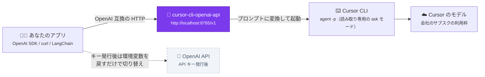
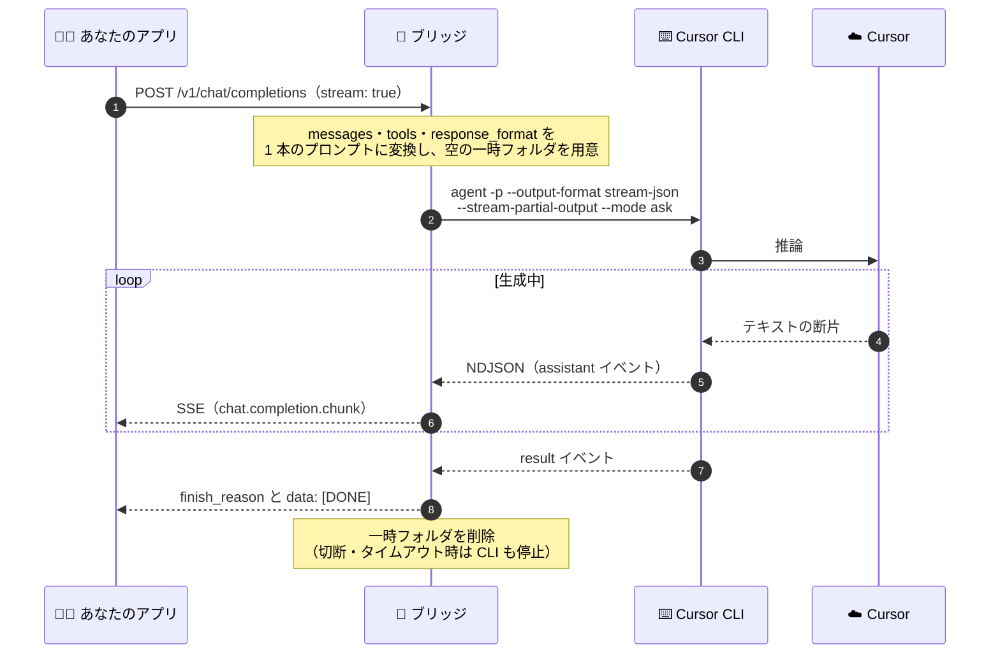
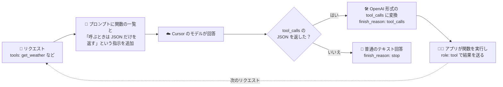
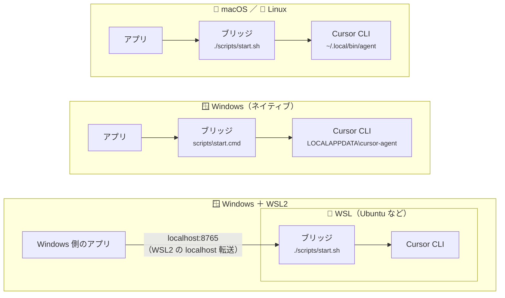
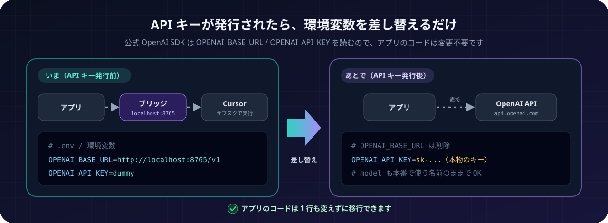
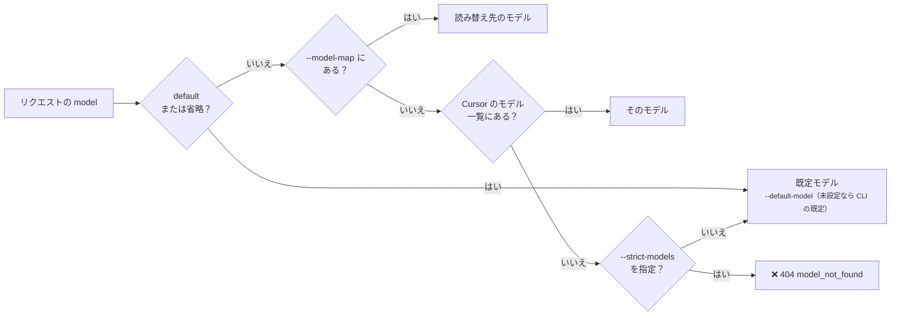

<p align="center">
  
</p>

<p align="center">
  
  
  
  
  
</p>

# cursor-cli-openai-api

**Cursor CLI を OpenAI 互換 API にする、ローカル専用のブリッジサーバーです。**
OpenAI の API キーがまだ無くても、会社の Cursor のサブスクで、OpenAI SDK を使うアプリをそのまま動かしてテストできます。

> [!WARNING]
> 非公式ツールです。Cursor（Anysphere, Inc.）および OpenAI とは関係ありません。
> 使い始める前に [利用規約と注意事項](#利用規約と注意事項必ずお読みください) を必ず読んでください。

## これは何？

こんなときのためのツールです。

- 🧑‍💻 OpenAI API を使うアプリを作っているが、**API キーの発行（社内申請など）を待っている**
- 🏢 でも、会社で **Cursor は契約している**
- ✅ SDK の呼び出し・ストリーミング・Function calling の流れを、**キーが届く前に確かめておきたい**

アプリから見ると「OpenAI API と同じ形の API」が手元（`localhost`）にあるだけです。裏では Cursor CLI が、あなたの Cursor の契約で答えを作ります。



## 特徴

| 機能 | 内容 |
| --- | --- |
| 🔌 **OpenAI 互換** | `/v1/chat/completions`・`/v1/responses`・`/v1/models`。公式 SDK（Python / Node.js）で動作確認済み（`chat.completions.parse` や `responses.stream` などのヘルパーも動きます） |
| 🌊 **ストリーミング** | SSE で少しずつ届きます。`stream_options.include_usage` にも対応 |
| 🛠️ **Function calling / JSON モード** | `tools`・`tool_choice`・`response_format`（Structured Outputs）をプロンプトで再現 |
| 🪶 **依存パッケージなし** | Python 標準ライブラリだけで動作。`pip install` 不要（Python 3.9 以上） |
| 💻 **マルチ OS** | Windows（ネイティブ / WSL）・macOS・Linux |
| 🛡️ **安全寄りの既定値** | 読み取り専用の ask モード、リクエストごとの空の一時フォルダ、`127.0.0.1` だけで待ち受け |

## 3 ステップで試す

```bash
agent login                                   # 1. Cursor CLI にログイン（初回のみ）
./scripts/start.sh                            # 2. ブリッジを起動（Windows は scripts\start.cmd）
export OPENAI_BASE_URL=http://localhost:8765/v1  # 3. 向き先を変えて、いつも通りアプリを起動
export OPENAI_API_KEY=dummy
```

インストールから順に知りたい場合は [セットアップ](#セットアップ) へ。

## 仕組み

### リクエスト 1 回の流れ

Cursor CLI は 1 回の実行が独立した会話なので、毎回これまでの会話（system / user / assistant / tool）をまとめて 1 本のプロンプトにして渡します。
CLI の出力（NDJSON）を受け取りながら、OpenAI 形式の SSE に変換してアプリへ流します。



### Function calling の再現

Cursor CLI には「関数を呼ぶ」仕組みが無いため、プロンプトで JSON 形式の返答を指示し、それを OpenAI 形式の `tool_calls` に変換しています。
JSON モード / Structured Outputs も同じ考え方で、返答からコードブロックなどを取り除いて JSON だけを返します。



## セットアップ

### 1. Cursor CLI をインストールしてログインする

| 環境 | インストールコマンド |
| --- | --- |
| macOS / Linux / WSL | `curl https://cursor.com/install -fsS \| bash` |
| Windows（PowerShell） | `irm 'https://cursor.com/install?win32=true' \| iex` |

インストール後、ターミナルを開き直してからログインします。

```bash
agent login        # ブラウザでログイン（WSL でブラウザが開かない場合: NO_OPEN_BROWSER=1 agent login）
agent status       # ログイン状態の確認
agent models       # 使えるモデル ID の確認
```

> コマンド名は新しい版では `agent`、旧名の `cursor-agent` も使えます。このサーバーはどちらも自動で探します。

### 2. このリポジトリを取得する

```bash
git clone https://github.com/check5004/cursor-cli-openai-api.git
cd cursor-cli-openai-api
```

Python が無い場合：macOS は `xcode-select --install` か Homebrew、Ubuntu / WSL は `sudo apt install python3`、
Windows は [python.org](https://www.python.org/downloads/windows/) からインストールしてください。

### 3. 環境チェック（任意）

```bash
python3 -m cursor_openai_api doctor               # CLI の場所・ログイン状態・モデル一覧を確認
python3 -m cursor_openai_api doctor --try-prompt  # 実際に 1 回だけ短い問い合わせをする（利用枠を少し消費）
```

Windows では `python3` の代わりに `py -3`（または `python`）を使います。

### 4. サーバーを起動する

| 環境 | 起動方法 |
| --- | --- |
| macOS / Linux | `./scripts/start.sh` |
| WSL（Cursor CLI を WSL に入れた場合） | WSL のターミナルで `./scripts/start.sh` |
| Windows ネイティブ | `scripts\start.cmd`（ダブルクリック可）または `py -3 -m cursor_openai_api` |
| Windows から WSL 内で起動 | `scripts\start-wsl.cmd`（リポジトリを `C:\` 側に置いた場合） |

起動すると次のように表示されます。

```
cursor-openai-api v0.1.0
  Cursor CLI : /home/you/.local/bin/cursor-agent
  Listening  : http://127.0.0.1:8765  (base_url = http://localhost:8765/v1)
  ...
```

`pipx` を使う場合は、どのフォルダからでも `cursor-openai-api` コマンドで起動できます。

```bash
pipx install git+https://github.com/check5004/cursor-cli-openai-api.git
cursor-openai-api --port 8765
```

#### どこで何が動くか

ブリッジと Cursor CLI は **同じ環境** で動かします（Windows の CLI を WSL のブリッジから呼ぶ、のような組み合わせはできません）。



#### WSL で動かす場合の補足

- WSL2 では、WSL 内で起動したサーバーに **Windows 側のアプリからも `http://localhost:8765/v1` でつながります**（localhost 転送）。
- つながらない場合は `./scripts/start.sh --host 0.0.0.0 --api-key 任意の文字列` で起動し、WSL の IP（`hostname -I`）宛てに接続するか、
  `%UserProfile%\.wslconfig` に `[wsl2]` `networkingMode=mirrored` を設定して WSL を再起動してください。
- Cursor CLI を Windows に、サーバーを WSL に、のように**別々に入れることはできません**。CLI を入れた側でサーバーを起動してください。

## 使い方

### 環境変数だけで切り替える（アプリのコード変更なし）

公式 OpenAI SDK（Python / Node.js）は環境変数 `OPENAI_BASE_URL` と `OPENAI_API_KEY` を読むので、アプリを起動するときに設定するだけで向き先を変えられます。

```bash
# macOS / Linux / WSL
export OPENAI_BASE_URL=http://localhost:8765/v1
export OPENAI_API_KEY=dummy   # --api-key を設定していなければ何でもよい
```

```powershell
# Windows PowerShell
$env:OPENAI_BASE_URL = "http://localhost:8765/v1"
$env:OPENAI_API_KEY = "dummy"
```

本物の API キーが発行されたら、これらの環境変数を本物の値に戻すだけで移行できます。

<p align="center">
  
</p>

### Python

```python
from openai import OpenAI

client = OpenAI(base_url="http://localhost:8765/v1", api_key="dummy")
res = client.chat.completions.create(
    model="default",
    messages=[{"role": "user", "content": "こんにちは"}],
)
print(res.choices[0].message.content)
```

### Node.js

```js
import OpenAI from "openai";

const client = new OpenAI({ baseURL: "http://localhost:8765/v1", apiKey: "dummy" });
const res = await client.chat.completions.create({
  model: "default",
  messages: [{ role: "user", content: "こんにちは" }],
});
console.log(res.choices[0].message.content);
```

### curl

```bash
curl http://localhost:8765/v1/chat/completions \
  -H "Content-Type: application/json" \
  -d '{"model":"default","messages":[{"role":"user","content":"こんにちは"}]}'
```

ストリーミング・Function calling・Responses API の例は [`examples/`](examples/) にあります。
LangChain の `ChatOpenAI(base_url=..., api_key=...)` など、OpenAI 互換の `base_url` を指定できるライブラリでも同じように使えます。

## モデルの指定

| リクエストの `model` | 実際に使われる Cursor のモデル |
| --- | --- |
| `default`（または省略） | `--default-model` の値。未設定なら Cursor CLI の既定モデル |
| Cursor のモデル ID（例: `auto`。`GET /v1/models` や `agent models` で確認） | そのモデル |
| `--model-map` で読み替えを設定した名前（例: `gpt-4o`） | 読み替え先のモデル |
| それ以外（例: アプリに書いてある `gpt-4o-mini`） | 既定モデルで実行（`--strict-models` を付けると 404 を返す） |



- 応答 JSON の `model` には、リクエストで指定した名前をそのまま返します。実際に使ったモデルはレスポンスヘッダー `x-cursor-model` で分かります。
- 例：`--model-map "gpt-4o=sonnet-4.5,gpt-4o-mini=auto"`（モデル ID はプランや時期で変わるので `agent models` で確認してください）

## 設定一覧

コマンドラインオプションと環境変数のどちらでも指定できます（オプションが優先）。

| オプション | 環境変数 | 既定値 | 説明 |
| --- | --- | --- | --- |
| `--host` | `HOST` | `127.0.0.1` | 待ち受けアドレス |
| `--port` | `PORT` | `8765` | 待ち受けポート |
| `--api-key` | `BRIDGE_API_KEY` | なし | 設定すると `Authorization: Bearer <値>` を必須にする |
| `--default-model` | `CURSOR_DEFAULT_MODEL` | CLI の既定 | `default`・未知のモデル名のときに使うモデル |
| `--model-map` | `MODEL_MAP` | なし | モデル名の読み替え（`a=b,c=d`） |
| `--strict-models` | `STRICT_MODELS=1` | オフ | 未知のモデル名を既定モデルに置き換えず 404 を返す |
| `--cursor-bin` | `CURSOR_AGENT_BIN` | 自動検出 | Cursor CLI のパス |
| `--agent-flags` | `CURSOR_AGENT_FLAGS` | `--trust --mode ask` | CLI に毎回渡すフラグ |
| `--workspace` | `CURSOR_WORKSPACE` | 一時フォルダ | CLI を実行するフォルダ |
| `--timeout` | `REQUEST_TIMEOUT` | `600` | 1 リクエストのタイムアウト（秒） |
| `--max-concurrency` | `MAX_CONCURRENCY` | `4` | CLI の同時実行数 |
| `--prompt-transport` | `PROMPT_TRANSPORT` | `auto` | プロンプトの渡し方（`auto` / `arg` / `file`）。`auto` は長いプロンプトだけファイル経由 |
| `--no-partial` | `NO_PARTIAL_OUTPUT=1` | オフ | 文字単位のストリーミングをやめる |
| `--no-preamble` | `NO_PREAMBLE=1` | オフ | 「API として素直に答えて」という前置き指示を付けない |
| `--cors-origin` | `CORS_ORIGIN` | なし | ブラウザから直接呼ぶときに許可する Origin |
| `--extra-models` | `EXTRA_MODELS` | なし | モデル一覧に手動で追加する ID |
| `--log-prompts` | `LOG_PROMPTS=1` | オフ | CLI に渡すプロンプト全文をログに出す |
| `-v`, `--verbose` | `VERBOSE=1` | オフ | 詳細ログ |

サブコマンド：`serve`（既定）、`doctor`、`models`。`python3 -m cursor_openai_api --help` で一覧を表示できます。

## 対応状況

| 機能 | 対応 | 補足 |
| --- | --- | --- |
| Chat Completions | ✅ | system / developer / user / assistant / tool メッセージ、マルチターン |
| ストリーミング（SSE） | ✅ | `stream_options.include_usage` にも対応 |
| 画像入力（`image_url`） | ✅ | data URL の画像は一時フォルダに保存して CLI に読ませる。`http(s)` の URL は文字列として渡す |
| Function calling（`tools` / `tool_choice` / `parallel_tool_calls`） | ✅（模擬） | プロンプトで JSON 出力を指示し、OpenAI 形式の `tool_calls` に変換 |
| JSON モード / Structured Outputs（`response_format`） | ✅（模擬） | プロンプトで指示し、コードブロックなどを除去。スキーマ準拠は保証されない |
| Responses API | ✅ | テキスト・function tools・`previous_response_id`（サーバーのメモリに保存。再起動で消える） |
| `usage`（トークン数） | 概算 | 文字数からの推定値 |
| `temperature` / `top_p` / `max_tokens` / `stop` / `seed` / `logprobs` | ❌ | 受け付けるが無視 |
| `n` > 1 | ❌ | 400 エラー |
| Embeddings / Images / Audio / 旧 Completions | ❌ | 501 エラー |
| Responses API の組み込みツール（`web_search` など） | ❌ | 無視 |

## 本物の OpenAI API との違い（テスト時の注意）

- **応答の傾向が違います。** Cursor のエージェント（独自のシステムプロンプト付き）を経由するため、同じモデルでも素の API とは答え方が変わります。
  インターフェース・処理フロー・エラーハンドリングの確認には向きますが、プロンプトの品質評価には向きません。
- **遅いです。** 1 リクエストごとに CLI を起動するため、数秒から十数秒の上乗せがあります（特に最初の 1 回）。
- Function calling と JSON モードはプロンプトでの模擬なので、まれに形式を守らないことがあります。
- エラーは OpenAI 形式で返します（未ログインは 401、利用上限は 429、タイムアウトは 504 など）。
  CLI 側の失敗では `x-should-retry: false` を返すので、公式 SDK が無駄に自動リトライしません。

## 利用規約と注意事項（必ずお読みください）

- **規約・社内ルールの確認**：利用には [Cursor の利用規約](https://cursor.com/terms-of-service) が適用されます。
  会社として Anysphere と契約（MSA）している場合はその契約が優先されます。会社のアカウントを使う場合は、
  「アプリのテストのために Cursor CLI を自動実行する」という使い方でよいか、事前に管理者へ確認することをおすすめします。
- **このツールがしていること**：Cursor が公式に提供している CLI のヘッドレス（print）モードを起動しているだけで、
  Cursor の非公開 API を直接呼んだり、認証トークンを取り出したりはしていません。
  Cursor のスタッフはフォーラムで、非公開エンドポイントを直接呼ぶ非公式プロキシは（個人・ローカル限定であっても）規約違反として扱われうること、
  CLI・SDK・Cloud Agents API が公式にサポートされた経路であることを説明しています
  （[フォーラムのスレッド](https://forum.cursor.com/t/does-using-oh-my-pi-s-cursor-provider-or-an-openai-compatible-proxy-to-the-same-endpoints-violate-cursor-s-tos/167778)、2026 年 8 月）。
  ただし、CLI を OpenAI 互換 API としてラップする使い方そのものを Cursor が明示的に認めたわけではありません。判断はご自身の責任でお願いします。
- **規約 1.5 の主な禁止事項（要約）**：
  - サービスの再販・貸与（このサーバーを他人やチーム外に公開して、あなたの契約で Cursor を使わせない）
  - 出力を使った競合モデルの開発・学習、モデル抽出
  - サービスからのデータの収集・スクレイピング
  - 再現に必要な情報なしでのベンチマーク結果の第三者への提供
  - HIPAA・PCI DSS などで特別に保護されたデータの送信
- **利用枠**：すべてのリクエストがあなた（またはチーム）の Cursor の利用枠を消費します。負荷試験や無限ループのような大量呼び出しには使わないでください。
- **データの扱い**：送ったプロンプトは Cursor とモデル提供元に送信されます。Privacy Mode などの設定を確認し、機密情報や個人情報は社内規程に従って扱ってください。
- **セキュリティ**：既定では `127.0.0.1` だけで待ち受けます。`--host 0.0.0.0` などで公開する場合は必ず `--api-key` を設定し、インターネットには公開しないでください。
  `--agent-flags` を `--mode agent` や `--force` に変えると、CLI がファイル編集やコマンド実行をできるようになるため推奨しません。
- **用途**：OpenAI の API キーを取得するまでの開発・テスト用です。本番環境では使わないでください。

## トラブルシューティング

| 症状 | 対処 |
| --- | --- |
| `Cursor CLI（agent / cursor-agent）が見つかりません` | CLI をインストールし、ターミナルを開き直す。それでもだめなら `--cursor-bin` でパスを指定 |
| 401 `cursor_not_authenticated` | `agent login` を実行（`agent status` で確認） |
| 500 `cursor_unknown_option` | CLI が古い可能性。`agent update` で更新するか、`CURSOR_AGENT_FLAGS=""` で追加フラグを外す |
| 応答が遅い・タイムアウトする | 最初の接続は 10〜15 秒かかることがあります。`--timeout` を延ばす。`--verbose` で CLI の出力を確認 |
| モデル一覧が `default` だけ | `agent models` を直接実行して確認。取得できない環境では `--extra-models` で追加 |
| Windows から WSL のサーバーにつながらない | [WSL で動かす場合の補足](#wsl-で動かす場合の補足) を参照 |
| Docker コンテナ内のアプリから使いたい | `--host 0.0.0.0 --api-key ...` で起動し、コンテナからは `http://host.docker.internal:8765/v1` に接続 |
| 意図しない応答になる | `--log-prompts` で CLI に渡したプロンプトを確認 |

## 開発

テストは本物の Cursor CLI の代わりに、出力形式を真似た偽 CLI（`tests/fake_cursor_agent.py`）を使います。Cursor の利用枠は消費しません。

```bash
python3 -m unittest discover -s tests -v
pip install openai   # 入れると公式 SDK での互換テストも実行される
```

テストは Windows / macOS / Linux、Python 3.9〜3.13 で動くように作っています。

## ライセンス

[MIT](LICENSE)
